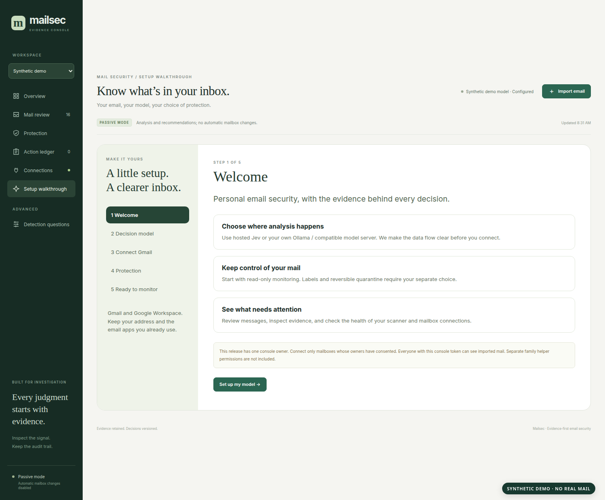
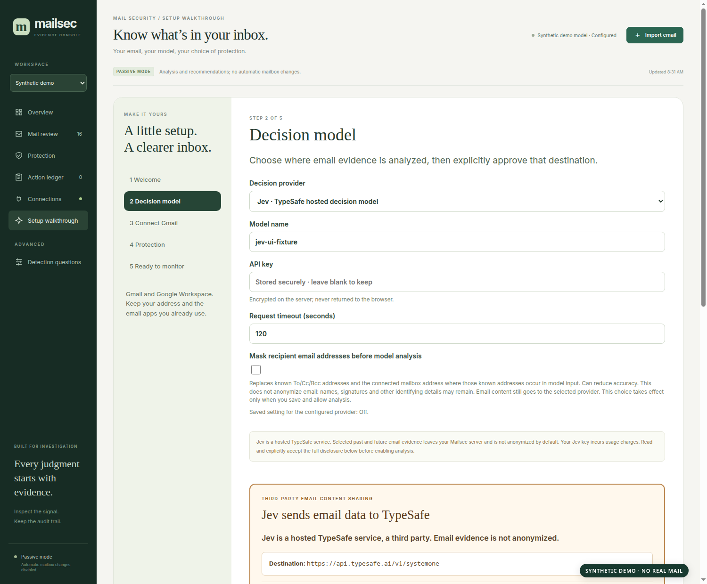
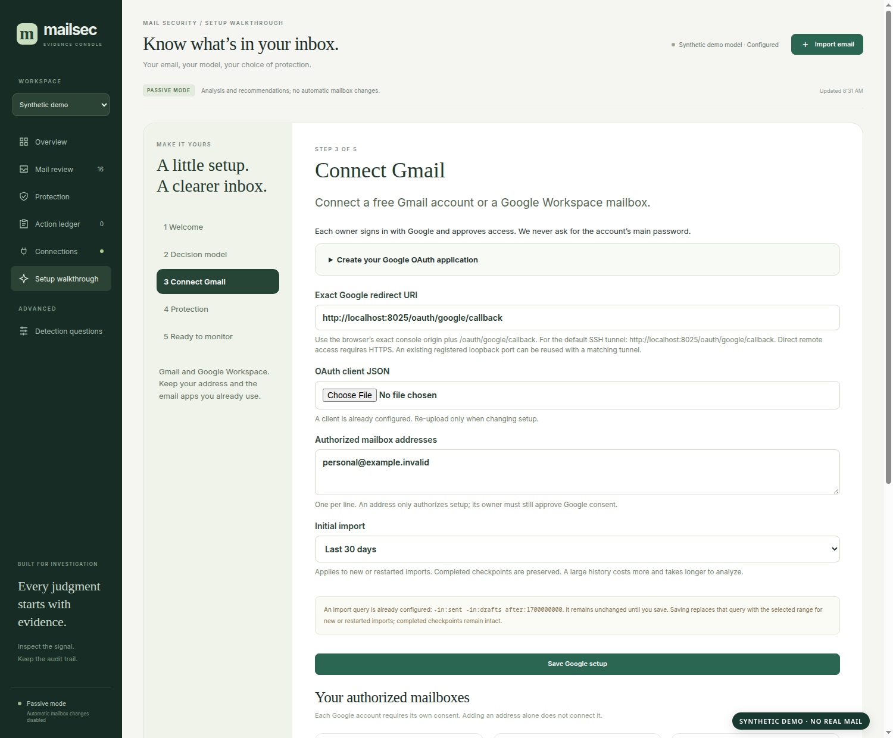
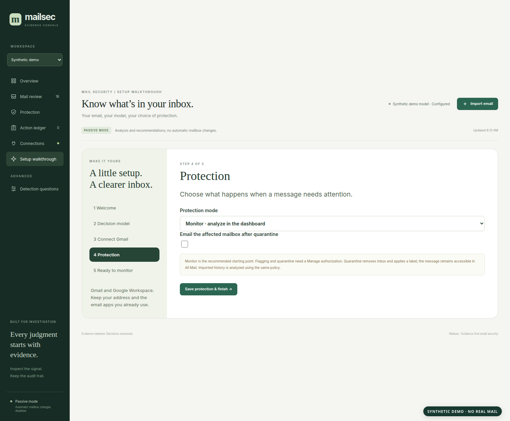
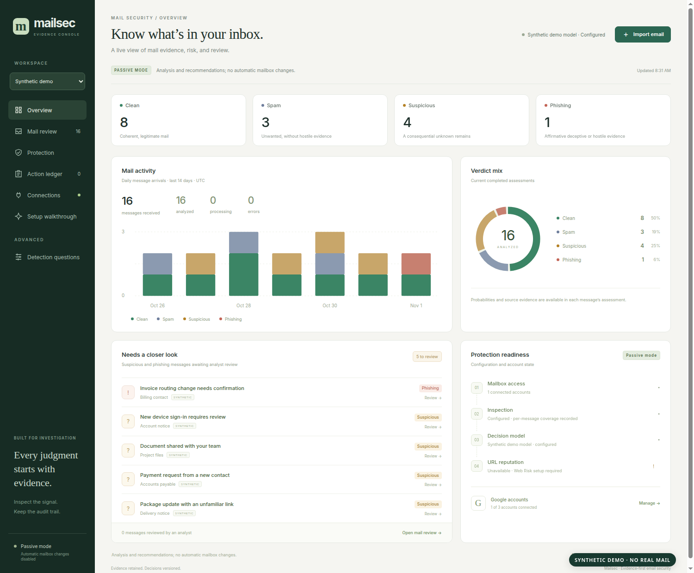
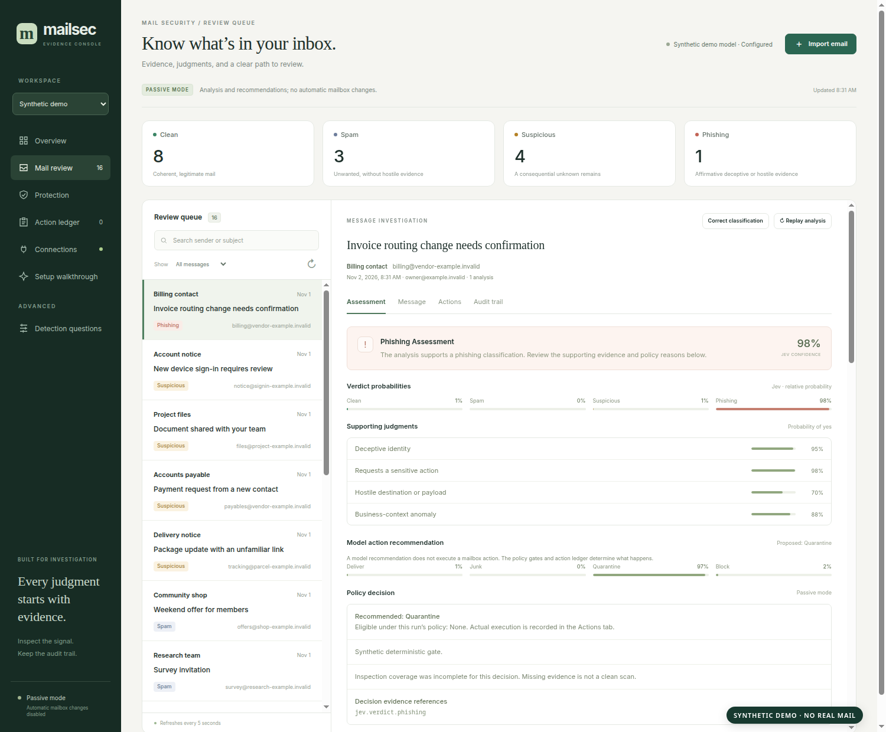

# Mailsec product tour

This is a visual walkthrough of **Mailsec `0.4.0-alpha.8`, its first public alpha
release**. Mailsec gives one trusted owner a console for monitoring personal
Gmail or Google Workspace mail after delivery. It runs the console, worker,
database, antivirus, and static attachment inspector in one Linux container.
An optional Ollama or compatible model server runs separately.

**Every screen below was generated from synthetic `.invalid` addresses and a
local UI fixture. No personal email, live account, API key, or measured detection
result appears in the images.** The visible model percentages and message counts
are invented to show the interface. The screenshots were captured without a
mouse cursor.

## 1. Open the first-run walkthrough

After starting `./selfhost.sh`, open `http://localhost:8025` on the host and get
the private console access token with `./selfhost.sh token`. For another device,
use the [documented SSH tunnel or HTTPS setup](self-hosting.md#access-from-another-device).
The walkthrough takes you through a decision provider, Google authorization,
and protection mode before you rely on analysis.

Starting the container does not connect a mailbox, spend model credits, or change
Gmail labels. The installation begins in passive monitoring mode with quarantine
notifications off. The first source build can take a while because it compiles
native components; the scanner also needs current antivirus signatures before
the worker begins processing.

## 2. Choose where decisions are made

The **Decision model** step supports TypeSafe's hosted **Jev**, **Ollama**, or an
**OpenAI-compatible** endpoint. The selected provider receives a bounded model
view of analyzed email. A compatible endpoint is only private when the server
you point Mailsec to is under your control.

**Jev sends selected email evidence to TypeSafe, a third party.** That may include
the connected mailbox and recipient addresses, sender identities, subject and
message text, complete URLs, and text extracted from documents, images, or QR
codes. This applies to the historical mail you choose to backfill as well as
future messages, retries, and replays. Mailsec keeps raw `.eml` files and binary
attachments on your host, but extracted content can still be shared. It does
not automatically anonymize the evidence.

The **Mask recipient email addresses** option is off by default. It replaces
known mailbox and To/Cc/Bcc addresses in the model view, including occurrences
in extracted text and supported URL spellings. Names, sender addresses, other
identifiers, or secrets in the message can remain. Masking can also hide context
that helps identify a scam. Mailsec requires a separate data-sharing acceptance
for the exact provider and destination, then a synthetic connection test and an
explicit **save and allow analysis** action. Google authorization alone does not
grant model data sharing. See [the full disclosure](data-sharing.md).

## 3. Connect personal Gmail or Google Workspace

Each installation supplies its **own Google Cloud project and OAuth Web client**;
Mailsec does not ship a shared Google credential. The guided step asks for the
client JSON, the mailbox addresses you intend to connect, and the initial
history window. Then each mailbox owner signs in with Google and approves access.
A free personal Gmail account works; Workspace is not required.

Choose **Monitor** for read-only Gmail access or **Manage** for labeling and
quarantine controls. Manage is Google's broader `gmail.modify` permission, which
also includes the ability to send mail. Mailsec separately limits what its own
policy is allowed to do. The initial history choices are new mail, the previous
30 days (default), or all available incoming history. Import checkpoints allow
a long backfill to resume; already completed history does not rewind simply
because you change the selection later. Archived, Spam, and Trash mail can be
listed, while Sent and Draft mail are excluded from automatic protection.

The [Google setup guide](gmail-setup.md) gives exact project, OAuth callback,
scope, and test-user steps. A Google External app left in Testing normally has
short-lived Gmail refresh authorization, so an unattended installation needs
its own Google production-access plan. Google Workspace administrators may also
limit third-party app access.

## 4. Set the mailbox response

Mailsec starts in **Monitor** mode: it analyzes and shows results without
automatically changing Gmail. You can later choose **Flag** to add
`Mailsec/Review` to eligible messages, or **Automatic quarantine** to add
`Mailsec/Quarantine` and remove an eligible message from Inbox. That message
remains in Gmail All Mail. Optional quarantine notifications are off by default.

Flagging and quarantine require Manage consent for that mailbox. A read-only
connection cannot change labels regardless of the selected mode. The model's
recommended action does not directly change Gmail: separate application policy
checks the verdict, evidence, inspection coverage, and protection settings
before an action is eligible. Local model estimates cannot by themselves trigger
model-only automatic quarantine. A scanner or model outage is displayed and
retried, never silently turned into a clean message.

## 5. Review the dashboard

The overview shows message totals, categories, trends, and a review queue. You
can switch between available workspaces, inspect a message, and see the latest
analysis and mailbox action state. The screenshot's category counts are sample
data, not a performance result.

**Clean** means a coherent routine or transactional message without an important
unresolved request. **Spam** means unwanted marketing or bulk mail without
affirmative fraud evidence. **Suspicious** means a consequential fact still needs
review. **Phishing** requires affirmative evidence of deception or a harmful
social-engineering request. Unknown reputation or missing enrichment alone does
not prove a link is malicious. A displayed model percentage is a score from that
model call, **not the measured probability that its verdict is right**.

## 6. Investigate and correct an individual message

The investigation view separates the original message, the model's category and
supporting judgments, evidence gaps, policy decision, and action history. You
can correct a category without erasing the original result. A later replay
preserves both the older assessment and your correction.

This synthetic invoice-routing example illustrates why identity and requested
actions matter. A message can pass authentication for its sending domain while
still making an unsupported claim about a vendor or payment route. Mailsec
compares the sender, reply-to, return-path, authenticated domains, and
consequential links, then asks the decision provider structured questions about
the claimed authority and requested action. The screenshot's 98% Jev score and
supporting percentages are fixture values, **not a real Jev assessment or an
accuracy measurement**.

With Manage access, the owner can optionally apply a matching custom Gmail
verdict label and move a message out of Inbox. A `Mailsec/Spam` label is a custom
label; it does not put the message in Gmail's system Spam folder. A correction
and a requested Gmail change are recorded separately. **Pending** means queued;
check the action ledger for confirmation or failure. Undo is available for
eligible manual label changes. A Clean correction does not automatically release
an existing quarantine; release has its own explicit control.

## What happens between Gmail and the dashboard

| Stage | What Mailsec records or checks | Where it happens |
| --- | --- | --- |
| Import | Gmail message ID, time, raw original, hash, and a resumable checkpoint | Mailsec host |
| Parsing | Visible and hidden text, quotes, true link targets, headers, attachment structure | Isolated local parser |
| Static inspection | ClamAV signatures, supported document and archive text, image OCR, QR contents, coverage gaps | Local scanner processes |
| Context | From/Reply-To/Return-Path relationships, Gmail-reported SPF/DKIM/DMARC, action destinations, configured context | Mailsec host |
| Decision | Versioned clean/spam/suspicious/phishing questions and supporting judgments; targeted extra action and authority questions when needed | Selected Jev, Ollama, or compatible endpoint |
| Policy | Rules that gate the effective verdict and eligible mailbox action; failures remain visible | Mailsec host |
| Response | Dashboard record, optional Gmail labels/Inbox change, and durable action outcome | Mailsec and, with Manage access, Gmail |

The [full nine-stage explanation](analysis-pipeline.md) describes sectioning of
long messages, exact trust limits for SPF/DKIM/DMARC, model inputs, question
stages, review thresholds, and label behavior. The [architecture guide](architecture.md)
covers the container's process boundaries. Detection wording can be edited in
**Advanced → Detection questions**, compared on a saved message, activated as a
version, copied or pasted as JSON text, and restored to shipped defaults. The
[question guide](detection-questions.md) explains that workflow and its limits.

## Current boundaries

This first public alpha is intended for **one trusted operator** on a supported
Linux x86-64 host. It needs enabled Landlock ABI 6 or later and at least 8 GiB
of available RAM for Mailsec, plus any memory needed by a separately run local
model. A NAS model name alone does not prove its kernel supports the isolation
Mailsec requires; the UGREEN DXP4800 Plus has not been validated on its actual
UGOS kernel. See [platform requirements](self-hosting.md#start-from-a-release-checkout).

Mailsec acts **after delivery** and cannot guarantee protection before an email
is opened or a link is clicked. It does not browse links, detonate attachments,
or provide click-time protection. Google Web Risk/URL reputation is optional and
**not configured in this alpha**. SPF/DKIM/DMARC results come from Gmail's trusted
receiving headers; Mailsec does not re-run old SPF checks or cryptographically
reverify historic DKIM. The console has one administrator token, without family
helper accounts or MSP tenant isolation. It does not support Microsoft 365 or
generic IMAP in this release.

No detection system catches every attack. This version has **no validated 99%
accuracy, precision, or recall claim**; model scores in the UI are not such a
claim. Read the [validation record](release-validation.md) for what has been
tested, and begin with passive monitoring on your own mail. If you connect a
loved one's mailbox, obtain their informed consent: the operator can read its
imported messages and attachments, and Jev or another configured endpoint may
receive selected evidence.
